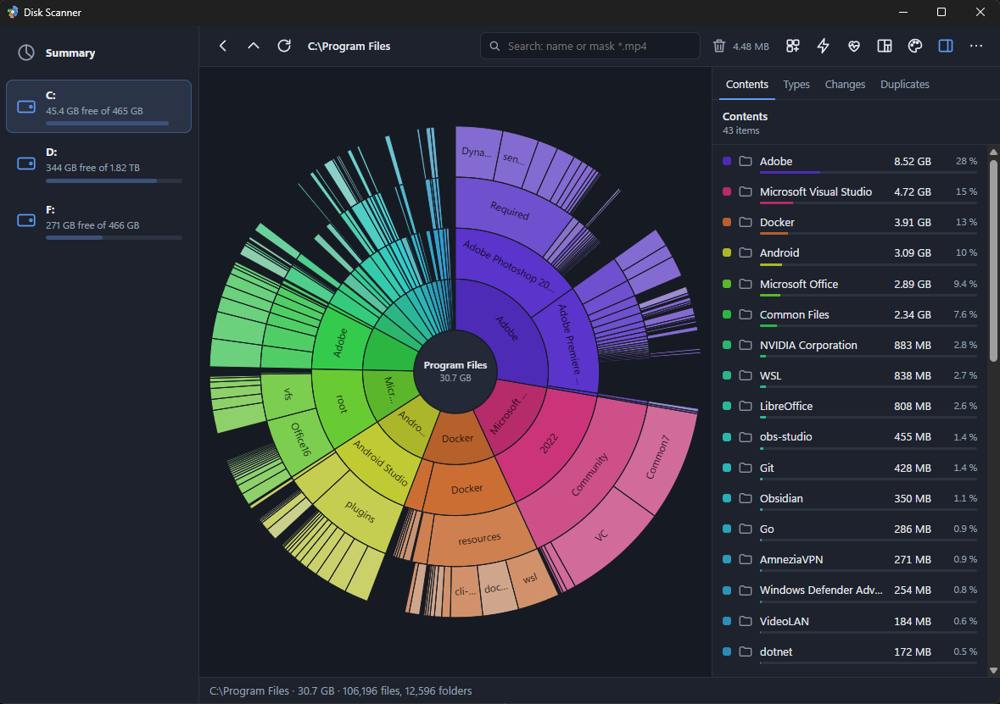
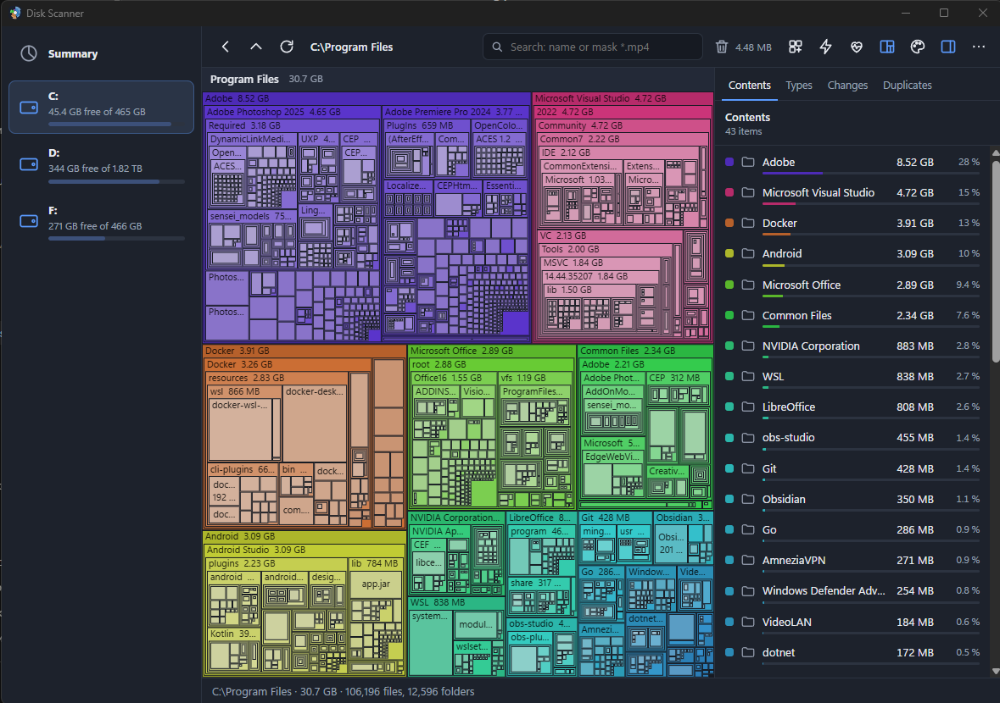
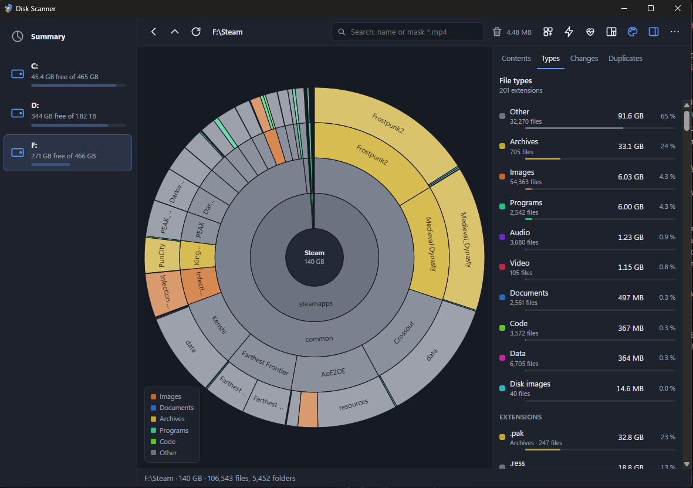

<div align="center">


# Disk Scanner

**See what takes up space on your Windows drives, all on one chart.**

[](https://github.com/Louxer3123/disk-scanner-ds/actions/workflows/ci.yml)
[](LICENSE)


**English** · [Русский](README.ru.md)

</div>

Every file and folder of your drives on one chart: rings (sunburst) or rectangles (treemap). A from-scratch rewrite of the classic Scanner 2.13 by Steffen Gerlach in Rust and Tauri. The interface is in English or Russian (**More → Language**). Architecture and design notes are in [SPEC.md](SPEC.md) (in Russian).

<p align="center">
  
</p>

<table>
  <tr>
    <td width="50%"></td>
    <td width="50%"></td>
  </tr>
  <tr>
    <td align="center">Treemap</td>
    <td align="center">Colours by file type, summary by extension</td>
  </tr>
</table>

## Features

- **Two charts:** sunburst or treemap; click to zoom in, Back and Up, tooltips, and a side panel listing entries by size.
- **Several drives at once** in a summary view. Drives are picked up as they are plugged in, and separate physical disks are scanned in parallel.
- **Live chart:** it grows while the first scan runs.
- **Fast mode:** NTFS drives are read straight from the master file table (MFT). A C: drive with 2 million files takes about 13 seconds. It needs administrator rights; the app restarts itself elevated.
- **Search** by name or mask (`*.mp4`), with matches highlighted on the chart.
- **Colours** by folder, by file type or by change since a snapshot, plus a summary by extension.
- **Snapshots** of a drive, and comparison with them: what grew, what is new, what was deleted.
- **Duplicates:** finds identical files by content (BLAKE3).
- **Export** to CSV (opens straight in Excel) and JSON.
- **Disk health**, in the spirit of CrystalDiskInfo:
  - a Good / Caution / Bad verdict;
  - temperature, power-on hours, power cycles, data written and SSD life left;
  - the S.M.A.R.T. attribute table for SATA disks and the NVMe health log.

  NVMe disks are read without administrator rights; SATA disks need them.
- **File actions:** open, show in Explorer, move to the Recycle Bin, delete permanently, rescan. The Recycle Bin can be emptied, and Explorer can get a "Show disk usage" menu item.
- **Look and feel:** dark and light themes, HiDPI.
- **Portable mode:** everything is kept next to the exe.

## Install

Windows 10 or 11 (x64). WebView2 ships with Windows, so no installer is needed.

- **`DiskScanner-<version>.exe`:** just run it. Settings and snapshots go to `%APPDATA%\io.github.diskscanner`.
- **`DiskScanner-<version>-portable.zip`:** unzip it anywhere, a USB stick included. While `portable.txt` lies next to the exe, settings, snapshots and cache stay in a `data` folder beside it, and nothing is left in the system.

**More → About** shows where the app's files are and how much space they take. To remove the app without a trace:

1. Turn off the Explorer menu item (under **More**).
2. Delete the exe and the folders that window lists.

Until the exe is signed with a certificate from a certificate authority, SmartScreen warns about an unknown publisher on first run: **More info → Run anyway**.

## Controls

| Action | How |
|---|---|
| Zoom into a folder | click a segment or a row in the side panel |
| Go up a level | click the centre of the rings (or the top bar in the treemap), `Alt+↑` |
| Back | `Backspace`, `Alt+←` |
| Rescan | `F5`; a folder: from the context menu |
| Search | `Ctrl+F`, `Esc` to clear |
| File actions | right-click a segment or a row |
| Disk health | the heart button on the toolbar |

## Build from source

You need:

- [Rust](https://rustup.rs/) (stable, edition 2024);
- [Node.js](https://nodejs.org/) 20 or newer;
- Microsoft C++ Build Tools (the rustup installer offers to install them).

```bash
npm --prefix app install
```

Run in development mode (the window reloads when the code changes):

```bash
npm --prefix app run tauri dev
```

Tests and checks:

```bash
cargo test --workspace
```

```bash
cargo clippy --workspace --all-targets
```

```bash
npm --prefix app run check
```

Release build: the exe and the portable zip land in `dist-release\`.

```bash
npm --prefix app run release
```

The release script signs the exe (Authenticode) when a certificate is configured. See [README.ru.md](README.ru.md#подпись-exe) for the environment variables.

## Command-line version

`crates/scanner-cli` builds `scanner.exe`. It scans a folder or a drive and prints a summary, CSV or JSON.

```bash
cargo run --release -p scanner-cli -- C:\Users -f csv -d 2 --min-size 1048576 -o users.csv
```

| Option | What it does |
|---|---|
| `-f summary\|json\|csv` | output format |
| `-d` | depth |
| `-n` | how many of the largest entries the summary shows |
| `--min-size` | skip anything smaller |
| `-o` | output file |
| `-j` | number of threads |
| `-q` | no progress output |

## Project layout

```
crates/scanner-core/   core: walking, MFT, tree, layouts, search, file types,
                       snapshots and diffs, duplicates, export, disk health;
                       tests and benchmarks (examples/)
crates/scanner-cli/    the console scanner.exe
app/src-tauri/         the Tauri app: commands, state, file actions,
                       settings and portable mode
app/src/               the TypeScript UI: rendering, panel, strings (i18n/)
app/scripts/           release build and signing
```

## License

[MIT](LICENSE). The original Scanner is not part of this repository. This version was written from a description of its behaviour, without its code.
